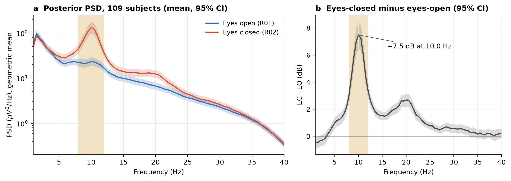
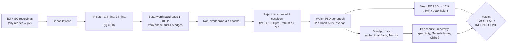
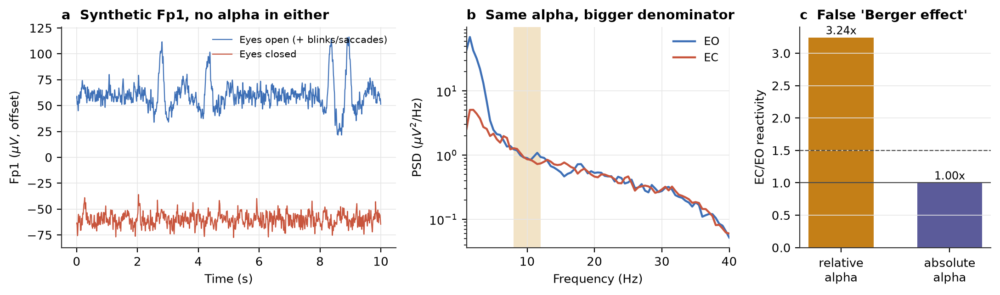
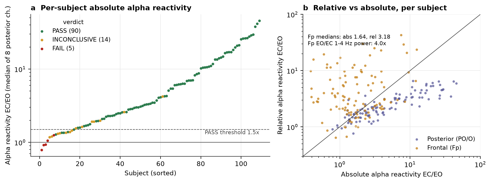
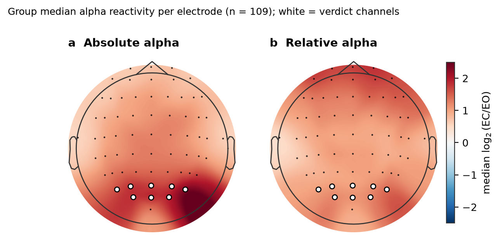
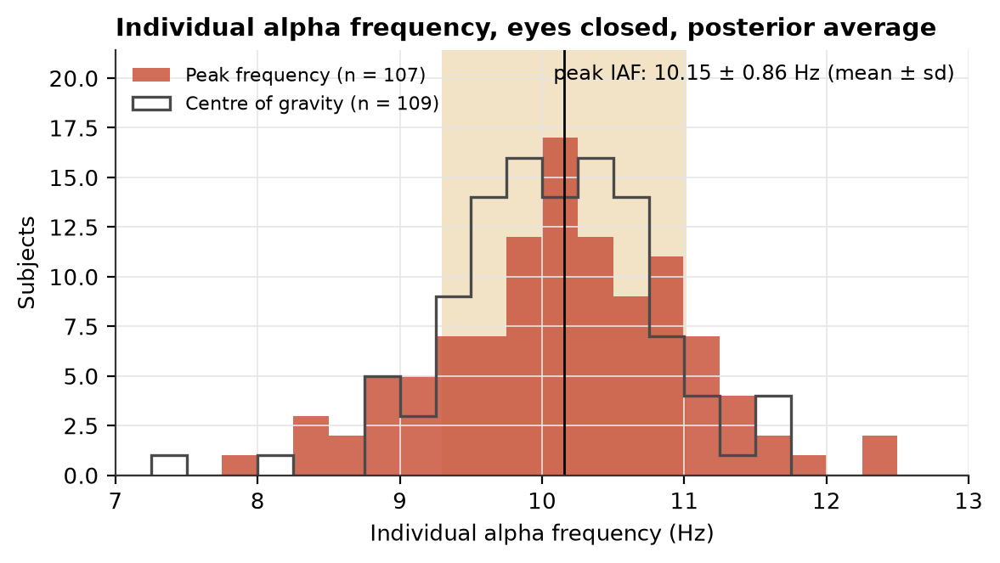

# eeg-alpha-bench

**Does your EEG actually see alpha?** A small, reproducible benchmark for the oldest sanity check in
electroencephalography: posterior alpha power (8–12 Hz) rises when the eyes close
(the Berger effect; Berger, 1929). Give it one eyes-open and one eyes-closed recording from any
headset (research cap, OpenBCI, Muse, a DIY board) and it returns **PASS / FAIL / INCONCLUSIVE**
with every number behind the verdict.

[](https://github.com/Tommycode3/eeg-alpha-bench/actions/workflows/tests.yml)




*Validated on all 109 subjects of the PhysioNet EEG Motor Movement/Imagery Dataset. Eyes closed
raises posterior power by **+7.5 dB at 10.0 Hz** (group mean). Thresholds were fixed before the
validation run; see [Validation](#validation-on-public-data).*

| PhysioNet EEGMMIDB, 109 subjects, 1 min EO + 1 min EC | result |
|---|---|
| Verdict PASS / INCONCLUSIVE / FAIL | **90 / 14 / 5** |
| Pass rate (Wilson 95% CI) | **82.6 %** (74.4–88.5 %) |
| Posterior alpha reactivity EC/EO, median [IQR] | **3.39×** [1.95–10.58] |
| Subjects with reactivity > 1 | 97.2 % (Wilcoxon signed-rank p = 8.9 × 10⁻²⁰) |
| Individual alpha frequency, mean ± sd | **10.15 ± 0.86 Hz** (n = 107 with a clear peak) |
| Frontal (Fp) reactivity: *relative* vs *absolute* alpha, median | **3.18× vs 1.64×**: relative alpha overstates it ~2× |

<!-- TODO(Tommaso): dictate 3-4 lines in your own words -->

## Contents

- [Quickstart](#quickstart)
- [Method](#method) (pipeline, equations, verdict)
- [The relative-alpha / EOG pitfall](#the-relative-alpha--eog-pitfall)
- [Validation on public data](#validation-on-public-data)
- [Tests on synthetic ground truth](#tests-on-synthetic-ground-truth)
- [Limitations](#limitations)
- [Adding a device adapter](#adding-a-device-adapter)
- [Citing](#citing) · [References](#references)

## Quickstart

```bash
git clone https://github.com/Tommycode3/eeg-alpha-bench && cd eeg-alpha-bench
python3 -m venv .venv && source .venv/bin/activate
pip install -e ".[dev]"

# record ~2 min eyes open (fixating a point) and ~2 min eyes closed, relaxed, then:
alphabench --eo eyes_open.edf --ec eyes_closed.edf --line-freq 50 --report report.html
```

```text
PASS
  - Alpha reactivity detected on Po7, Po3, Poz, Po4, Po8, O1, Oz, O2 (8/8 eligible channels).
report: report.html
```

The report is a single self-contained file: verdict, reasons, PSD figure, a per-channel table and
the full configuration. Examples from PhysioNet subject S004:
[`examples/S004_report.html`](examples/S004_report.html), [`examples/S004_report.md`](examples/S004_report.md).

| Input | `--format` | Notes |
|---|---|---|
| EDF / BDF / FIF / BrainVision / EEGLAB | `auto` (or `edf`, `bdf`, `fif`) | via `mne.io.read_raw`, EEG channels only |
| Generic CSV | `csv` | a `time` column (s) **or** `--sfreq`; one column per channel; `--units uV/mV/V` |
| Muse (`muselsl record`, Mind Monitor) | `muse` | TP9, AF7, AF8, TP10; Mind Monitor marker rows dropped |
| OpenBCI GUI `.txt` | `openbci` | sample rate read from the `%` header; `EXG Channel N` columns |

Useful flags: `--channels O1,O2` (case-insensitive), `--line-freq 60` (Americas), `--json out.json`,
`--strict` (exit status 1 unless PASS: drop it into a hardware CI job). From Python:

```python
from alphabench import analyze, load, Config
res = analyze(load("eo.csv"), load("ec.csv"), Config(line_freq=50))
res.verdict, res.reasons, res.channels  # str, list[str], pandas.DataFrame
```

## Method



All parameters live in one frozen dataclass, [`src/alphabench/config.py`](src/alphabench/config.py).

### 1. Preprocessing and epochs

Each channel is linearly detrended, notched at the mains frequency and its harmonics below Nyquist
(second-order IIR notch, $Q=30$), and band-passed 1–40 Hz with a 4th-order Butterworth prototype
applied forward and backward (`scipy.signal.sosfiltfilt`), so the filter has zero phase and the
alpha peak is neither shifted nor distorted. One second is trimmed at each end, and the signal is cut
into **non-overlapping 4 s epochs** (non-overlap keeps the epochs closer to independent for the test
in §5).

**Artifact rejection** works per channel and per condition, so one bad electrode does not discard
the others. A channel-epoch with peak-to-peak amplitude $a$ is rejected if it is flat
($a < 1\,\mu V$), saturated ($a > 1000\,\mu V$), or a robust outlier of its own condition
(Iglewicz & Hoaglin, 1993):

$$
z = \frac{0.6745\,\bigl(\ln a - \operatorname{median}(\ln a)\bigr)}{\operatorname{MAD}(\ln a)} > 3.5 .
$$

The robust rule is relative to the condition's own amplitude distribution, so strong eyes-closed
alpha is never rejected merely for being large (a fixed µV threshold does exactly that; see the
[deviation note](#pre-registration-and-the-one-deviation)).

### 2. Power spectral density (Welch, 1967)

Each epoch is split into $K$ segments $x_k[n]$ of length $L = 2\,\text{s}\cdot f_s$ with 50 % overlap,
windowed by a Hann window $w[n]$, and the periodograms are averaged:

$$
\hat P(f) \;=\; \frac{2}{K\, f_s \sum_{n=0}^{L-1} w[n]^2}\;\sum_{k=1}^{K}\Bigl|\sum_{n=0}^{L-1} w[n]\,x_k[n]\,e^{-i 2\pi f n / f_s}\Bigr|^2
\qquad [\mu V^2/\text{Hz}],
$$

one-sided (factor 2 except at DC and Nyquist), frequency resolution $\Delta f = 1/2\,\text{s} = 0.5$ Hz.
With a 4 s epoch, $K = 3$.

### 3. Band power: absolute and relative alpha

Band power is the integral of the PSD over the band, evaluated with the trapezoidal rule:

$$
P_{[f_1,f_2]} \;=\; \int_{f_1}^{f_2} \hat P(f)\,df \;\approx\; \sum_j \tfrac{\Delta f}{2}\bigl(\hat P(f_j)+\hat P(f_{j+1})\bigr)
\qquad [\mu V^2].
$$

For a sinusoid of amplitude $A$ inside the band, $P = A^2/2$ (checked in the test suite).

$$
P_\alpha = P_{[8,12]}, \qquad
\rho_\alpha = \frac{P_{[8,12]}}{P_{[1,40]}} \quad\text{(relative alpha)} .
$$

### 4. Reactivity and alpha specificity

For each channel, with medians over clean epochs,

$$
R_\alpha = \frac{\operatorname{median}_{\text{EC}} P_\alpha}{\operatorname{median}_{\text{EO}} P_\alpha},
\qquad
R_{\text{flank}} = \frac{\operatorname{median}_{\text{EC}} \bigl(P_{[4,7]}+P_{[14,30]}\bigr)}{\operatorname{median}_{\text{EO}} \bigl(P_{[4,7]}+P_{[14,30]}\bigr)},
\qquad
S = \frac{R_\alpha}{R_{\text{flank}}} .
$$

$R_\alpha$ is the classic EC/EO reactivity ratio, on **absolute** power. $S$ asks whether the change
is *specific to alpha*: a better electrode contact, a different amplifier gain, or a broadband
impedance change between the two sessions scales every band by the same factor $g^2$, giving
$R_\alpha = R_{\text{flank}} = g^2$ and $S = 1$. The relative reactivity
$R_\rho = \operatorname{median}_{\text{EC}}\rho_\alpha / \operatorname{median}_{\text{EO}}\rho_\alpha$
is reported but never used for the verdict (next section).

### 5. Statistics and effect size

The unit of observation is one clean epoch. On $x_i = \log_{10} P_\alpha$ (EC, $i = 1..n_x$) and
$y_j = \log_{10} P_\alpha$ (EO, $j=1..n_y$), the one-sided Mann–Whitney test (Mann & Whitney, 1947) of
$H_1$: EC stochastically greater than EO uses

$$
U = \sum_{i=1}^{n_x}\sum_{j=1}^{n_y}\Bigl(\mathbb 1[x_i > y_j] + \tfrac12\,\mathbb 1[x_i = y_j]\Bigr),
$$

with the exact null distribution for small samples without ties (SciPy `method="auto"`). The
effect size is **Cliff's delta** (Cliff, 1993), the rank-biserial correlation:

$$
\delta = P(X>Y) - P(X<Y) = \frac{2U}{n_x n_y} - 1 \in [-1, 1] .
$$

The family-wise error is controlled with Bonferroni over the $m$ eligible channels. A one-sided
permutation test on the difference of mean $\log_{10} P_\alpha$ (5000 permutations, $p = (b+1)/(N+1)$;
Phipson & Smyth, 2010) is reported alongside as a check.

### 6. Individual alpha frequency (IAF)

On the mean eyes-closed PSD, the aperiodic (1/f) background is fitted by least squares in log–log
coordinates outside the alpha band (in the spirit of Donoghue et al., 2020):

$$
\log_{10}\hat P(f) \approx b - \chi \log_{10} f, \qquad f \in [2,7]\cup[14,30]\ \text{Hz}.
$$

The **peak alpha frequency** is the local maximum $f_j$ in 7–13 Hz that stands highest above the fit,
refined by a parabola through $\ell_{j-1}, \ell_j, \ell_{j+1}$ (with $\ell=\log_{10}\hat P$):

$$
\text{IAF} = f_j + \frac{\Delta f}{2}\,\frac{\ell_{j-1}-\ell_{j+1}}{\ell_{j-1}-2\ell_j+\ell_{j+1}},
\qquad
h = 10\log_{10}\frac{\hat P(f_j)}{10^{\,b-\chi\log_{10} f_j}}\ \ [\text{dB}] .
$$

If there is no local maximum, IAF is undefined (an edge maximum of a falling 1/f spectrum is not a
peak). The **centre of gravity** (Klimesch, 1999) over the residual above the fit is also reported:
$\text{CoG} = \sum f\,(\hat P - \hat P_{\text{fit}})^+ / \sum (\hat P - \hat P_{\text{fit}})^+$.
See Corcoran et al. (2018) for a careful treatment of automated IAF estimation.

### 7. Verdict

A channel is **eligible** if it is not frontal (Fp\*, AF\*, F1–F10, Fz: see next section) and has at
least 10 clean epochs per condition. The thresholds below were fixed in code before any real data
were analysed.

| Verdict | Rule |
|---|---|
| **PASS** | at least one eligible channel meets **all** of: $p_{\text{MWU}} < 0.01/m$; $R_\alpha \ge 1.5$; $S \ge 1.3$; $\delta \ge 0.33$; EC peak height $h \ge 1$ dB |
| **FAIL** | there are eligible channels, and none shows even nominal evidence ($p < 0.05$ and $R_\alpha \ge 1.2$) |
| **INCONCLUSIVE** | otherwise: some evidence but not all criteria; or no eligible channel (too little clean data, or frontal channels only) |

Each channel also gets flags: `frontal`, `few_epochs`, `eog_suspect` (EO power in 1–4 Hz at least
2× EC), and `relative_only` (relative alpha rose by ≥ 1.5× while absolute alpha rose by < 1.2×).

## The relative-alpha / EOG pitfall

Relative alpha $\rho_\alpha = P_\alpha / P_{\text{tot}}$ is popular because it cancels gain. But it
has a denominator, and eyes-open has something eyes-closed does not: **blinks and saccades** (EOG),
which put large power below ~4 Hz, strongest at frontal sites.

Let the eyes-open total power be $P_{\text{tot}} = P_\alpha + P_{\text{rest}}$, and let the ocular
artifact add $E$ to it (mostly in 1–4 Hz, so nothing to $P_\alpha$). With **identical** alpha in
both conditions,

$$
\frac{\rho_\alpha^{\text{EC}}}{\rho_\alpha^{\text{EO}}}
= \frac{P_\alpha / P_{\text{tot}}}{P_\alpha / (P_{\text{tot}} + E)}
= 1 + \frac{E}{P_{\text{tot}}} \;>\; 1 ,
\qquad\text{while}\qquad
\frac{P_\alpha^{\text{EC}}}{P_\alpha^{\text{EO}}} = 1 .
$$

If the 1–4 Hz band carries a fraction $\beta$ of the total power and EOG multiplies it by $k$, the
spurious relative "reactivity" is $1 + (k-1)\beta$. For a $1/f$ spectrum on 1–40 Hz,
$\beta = \ln 4 / \ln 40 \approx 0.38$; with the median frontal $k \approx 4.0$ measured on PhysioNet
that is $1 + 3 \times 0.38 \approx 2.1\times$ of inflation, before any alpha is involved. The data
agree: at Fp sites, relative reactivity is **3.18×** but absolute only **1.64×**
(medians over 109 subjects), a factor of 1.94.

Synthetic ground truth makes it explicit: no alpha anywhere, ocular artifact in eyes-open only.
Relative alpha reports a 3.2× "Berger effect"; absolute alpha correctly reports 1.0×.



So this tool (1) decides on **absolute** alpha, (2) requires an alpha-**specific** change ($S$) and a
genuine **spectral peak**, (3) excludes **frontal** channels from the verdict, and (4) flags
`relative_only` and `eog_suspect` channels in the report. A Muse (TP9, AF7, AF8, TP10) can therefore
pass only on its temporal-parietal TP9/TP10 electrodes.

## Validation on public data

**Dataset.** PhysioNet EEG Motor Movement/Imagery Dataset (Schalk et al., 2004; Goldberger et al.,
2000): 109 subjects, 64-channel BCI2000 cap, 160 Hz. Run **R01** = 1 min eyes-open baseline,
**R02** = 1 min eyes-closed baseline. Downloaded with `mne.datasets.eegbci` (Gramfort et al., 2013).
No subject is excluded; there were zero load errors.

**Protocol.** Default configuration, except `line_freq=60` (US recordings). Verdict channels fixed
in advance: PO7, PO3, POz, PO4, PO8, O1, Oz, O2. All 64 channels are analysed for the topography.

```bash
python validation/run_physionet.py      # ~2.5 min on a laptop, one subject in memory at a time
python validation/make_figures.py       # redraw figures from the committed CSVs
```

Outputs, committed: [`summary.md`](validation/results/summary.md),
[`summary.json`](validation/results/summary.json), per-subject
[`subjects.csv`](validation/results/subjects.csv), per-channel
[`posterior_channels.csv`](validation/results/posterior_channels.csv), group PSD and topography CSVs.

### Results

| metric | value |
|---|---|
| PASS / INCONCLUSIVE / FAIL | 90 / 14 / 5 |
| pass rate (Wilson 95 % CI) | 82.6 % (74.4–88.5 %) |
| posterior alpha reactivity EC/EO, median [IQR] | 3.39 [1.95–10.58] |
| subjects with reactivity > 1 / ≥ 1.5 | 97.2 % / 85.3 % |
| Wilcoxon signed-rank, $\log R_\alpha > 0$ | p = 8.9 × 10⁻²⁰ |
| IAF, peak, mean ± sd (n with a ≥ 1 dB peak) | 10.15 ± 0.86 Hz (n = 107) |
| IAF, centre of gravity, mean ± sd | 10.07 ± 0.72 Hz (n = 109) |
| clean epochs per condition, median (min) | 14 (11) of 14 |



**(a)** Every subject, sorted by posterior reactivity and coloured by verdict. **(b)** Relative vs
absolute reactivity per subject: posterior channels fall *below* the identity line (relative
alpha is diluted because eyes-closed also raises beta, see the group PSD), frontal channels sit far
*above* it, many at an absolute ratio near 1: the EOG denominator effect, in real data.



Absolute reactivity is maximal over parieto-occipital cortex, as expected for the Berger effect; the
relative measure is spatially flatter and is inflated at the frontal edge.



### What PASS rate should you expect?

Not 100 %. The 19 non-PASS subjects are mostly people whose alpha barely changes between conditions,
not missing alpha: their median eyes-closed alpha peak still stands 5–6 dB above the 1/f background,
but their median reactivity is 0.93× (FAIL) and 1.50× (INCONCLUSIVE). A weak Berger effect in a
minority of healthy adults is a known phenomenon; eyes-open in a dim room with little visual input
also lets alpha survive. **Test a device with a person you already know is a strong reactor.**

With only 1 minute per condition (≈ 14 epochs), the Bonferroni-corrected test is the binding
criterion. Sensitivity analysis (for transparency only, the verdict is never changed):

| criteria | pass rate |
|---|---|
| all criteria (the verdict) | 82.6 % |
| without the Bonferroni-corrected p | 93.6 % |
| without $R_\alpha \ge 1.5$ | 82.6 % |
| without specificity $S \ge 1.3$ | 83.5 % |
| without Cliff's $\delta \ge 0.33$ | 82.6 % |
| without the alpha peak | 82.6 % |

Recording 2–3 minutes per condition is the cheapest way to make the test more sensitive.

### Pre-registration and the one deviation

The verdict thresholds in `config.py` were written before any real data were analysed and were not
changed after seeing results. In order:

1. While building the synthetic tests (no real data yet), a null test failed: a broadband amplitude
   difference between two recordings produced a PASS. The **alpha-specificity criterion** $S$ was
   added to fix that, before any PhysioNet subject was processed.
2. **Deviation, disclosed.** The first trial run (subjects 1–4) used a fixed rejection threshold of
   200 µV peak-to-peak. It rejected most *eyes-closed* epochs (EEGMMIDB eyes-closed posterior epochs
   have a median peak-to-peak of 300–400 µV, largely alpha itself), leaving 0–9 clean eyes-closed
   epochs and an INCONCLUSIVE verdict on 3 of 4 subjects. Rejecting the signal under test is a method
   bug, so the fixed threshold was replaced by the per-condition robust rule (§1) with a loose
   1000 µV ceiling. No verdict threshold was touched. After a 6-subject smoke test, the full
   109-subject run was made with this configuration; the pipeline is deterministic, and re-running
   it reproduces the committed numbers exactly.

## Tests on synthetic ground truth

`pytest` (40 tests, ~7 s, no downloads) checks the method against signals whose truth is known:

| Scenario | Expected | Checked |
|---|---|---|
| 1/f noise + 6 µV bursting 10 Hz alpha in EC (O1/O2) | PASS, IAF within 0.3 Hz | ✔ 3 seeds; 8.5 and 11.5 Hz tracked |
| Pure 1/f noise in both conditions | never PASS | ✔ 8 seeds + 20-seed false-positive check |
| EOG (blinks + saccades) in EO only, no alpha | never PASS; Fp1 relative ratio > 1.5 but absolute < 1.2; flagged | ✔ 5 seeds |
| Whole EC recording at 2× gain, no alpha | never PASS ($R_\alpha$ > 3 but $S$ < 1.3) | ✔ 3 seeds |
| Alpha on frontal channels only | not PASS (no eligible channel) | ✔ |
| 20 s of data | INCONCLUSIVE, not FAIL | ✔ |
| Flat channel | rejected; other channels still decide | ✔ |
| Strong alpha **and** EOG | still PASS | ✔ |
| Band power of a sinusoid | $A^2/2$ within 2 % | ✔ |
| Notch + drift removal | 50 Hz suppressed > 40 dB, alpha power preserved within 5 % | ✔ |
| Readers | CSV, Muse (muselsl + Mind Monitor), OpenBCI, FIF round-trip; CLI end to end | ✔ |

## Limitations

- **Within-session statistics.** Epochs from one recording are not strictly independent (slow drifts
  in arousal and electrode impedance). The p-value is a single-subject, single-session device check,
  not population inference.
- **Two separate recordings.** EO and EC are compared across recordings, so anything else that
  changes between them (contact, posture, drowsiness) is confounded with eye state. The specificity
  criterion removes broadband changes, not band-specific ones.
- **Fixed 8–12 Hz band.** Subjects with IAF near 8 or 12 Hz lose part of their alpha. IAF is reported
  so you can see it; an IAF-anchored band would be a reasonable extension.
- **No ocular correction.** EOG is handled by design (absolute power, specificity, peak, frontal
  exclusion), not by ICA or regression. Channels with unknown labels (e.g. `EXG0`) cannot be
  recognised as frontal; rename them to 10-20 labels when you can.
- **Validation is on one wet-gel research dataset.** It shows the method behaves sensibly on good
  data. It is not a validation of any consumer or dry-electrode device; for those, the honest test is
  to run this tool on that device.
- **Artifact rejection is amplitude-based** and per condition: it catches pops and saturation, not
  subtle EMG.

## Adding a device adapter

A reader is a function `path -> Recording` with data in microvolts, shape `(n_channels, n_samples)`:

```python
# src/alphabench/io.py
def read_mydevice(path, sfreq=None, **_):
    df = pd.read_csv(path, sep=";")
    chans = ["O1", "O2", "Pz"]                  # use 10-20 labels so frontal sites are recognised
    data = df[chans].to_numpy().T * 0.02235     # ADC counts -> µV for your front end
    return Recording(data, sfreq or 250.0, chans, str(path))

READERS["mydevice"] = read_mydevice
```

Then optionally teach `detect_format` to recognise the file, add the name to the CLI `--format`
choices (automatic, they come from `READERS`), and add a small round-trip test in
`tests/test_io_cli.py`. Pull requests with real (anonymised, consented) example recordings are
very welcome.

## Repository layout

```text
src/alphabench/   config.py · io.py · signal_proc.py · stats.py · analysis.py · report.py · cli.py · synthetic.py
tests/            synthetic ground-truth, signal-processing, I/O and CLI tests
validation/       run_physionet.py · make_figures.py · results/ (CSV, JSON, MD) · figures/ (PNG)
examples/         S004_report.html / .md (PhysioNet subject 4)
```

## Citing

If you use this, please cite it via [`CITATION.cff`](CITATION.cff) and cite the PhysioNet dataset
(Schalk et al., 2004; Goldberger et al., 2000).

## References

- Barry, R. J., Clarke, A. R., Johnstone, S. J., Magee, C. A., & Rushby, J. A. (2007). EEG differences between eyes-closed and eyes-open resting conditions. *Clinical Neurophysiology*, 118(12), 2765–2773.
- Berger, H. (1929). Über das Elektrenkephalogramm des Menschen. *Archiv für Psychiatrie und Nervenkrankheiten*, 87, 527–570.
- Cliff, N. (1993). Dominance statistics: Ordinal analyses to answer ordinal questions. *Psychological Bulletin*, 114(3), 494–509.
- Corcoran, A. W., Alday, P. M., Schlesewsky, M., & Bornkessel-Schlesewsky, I. (2018). Toward a reliable, automated method of individual alpha frequency (IAF) quantification. *Psychophysiology*, 55(7), e13064.
- Donoghue, T., Haller, M., Peterson, E. J., et al. (2020). Parameterizing neural power spectra into periodic and aperiodic components. *Nature Neuroscience*, 23, 1655–1665.
- Goldberger, A. L., Amaral, L. A. N., Glass, L., et al. (2000). PhysioBank, PhysioToolkit, and PhysioNet: Components of a new research resource for complex physiologic signals. *Circulation*, 101(23), e215–e220.
- Gramfort, A., Luessi, M., Larson, E., et al. (2013). MEG and EEG data analysis with MNE-Python. *Frontiers in Neuroscience*, 7, 267.
- Iglewicz, B., & Hoaglin, D. C. (1993). *How to Detect and Handle Outliers*. ASQC Quality Press.
- Klimesch, W. (1999). EEG alpha and theta oscillations reflect cognitive and memory performance: a review and analysis. *Brain Research Reviews*, 29(2–3), 169–195.
- Mann, H. B., & Whitney, D. R. (1947). On a test of whether one of two random variables is stochastically larger than the other. *Annals of Mathematical Statistics*, 18(1), 50–60.
- Phipson, B., & Smyth, G. K. (2010). Permutation p-values should never be zero: calculating exact p-values when permutations are randomly drawn. *Statistical Applications in Genetics and Molecular Biology*, 9(1), Article 39.
- Schalk, G., McFarland, D. J., Hinterberger, T., Birbaumer, N., & Wolpaw, J. R. (2004). BCI2000: A general-purpose brain-computer interface (BCI) system. *IEEE Transactions on Biomedical Engineering*, 51(6), 1034–1043.
- Virtanen, P., Gommers, R., Oliphant, T. E., et al. (2020). SciPy 1.0: Fundamental algorithms for scientific computing in Python. *Nature Methods*, 17, 261–272.
- Welch, P. D. (1967). The use of fast Fourier transform for the estimation of power spectra: A method based on time averaging over short, modified periodograms. *IEEE Transactions on Audio and Electroacoustics*, 15(2), 70–73.

## License

Code: MIT, © 2026 Tommaso Maggiolo. The PhysioNet EEGMMIDB data are not redistributed here; they are
downloaded from PhysioNet under their own license (ODC Attribution). Committed results are derived
summary statistics.
